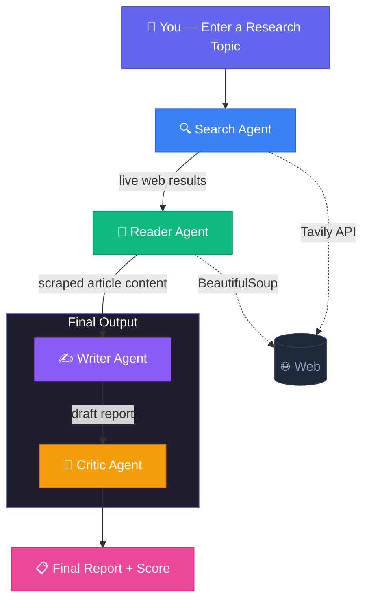

<div align="center">

# 🔬 DeepLens

### Your AI Research Team That Never Sleeps

An autonomous multi-agent system that searches the web, reads articles, writes reports, and critiques its own work — so you don't have to.

[](https://multi-agent-ai-research-system-o6dm.onrender.com)

</div>

---

## What Does It Do?

Give DeepLens any research topic, and it does what a human researcher would — but in seconds:

1. **Searches** the live web for the latest, most reliable information
2. **Reads** the best sources by scraping and extracting key content
3. **Writes** a structured, professional research report
4. **Critiques** the report for accuracy, depth, and quality — with a score out of 10

You get a polished report and honest feedback, ready to download.

---

## How It Works

DeepLens uses four specialized AI agents, each with a single job, working together like a research team:



| Agent | Role | Powered By |
|:------|:-----|:-----------|
| 🔍 **Search Agent** | Finds the freshest, most relevant sources from across the internet | Tavily API |
| 📖 **Reader Agent** | Visits the best links and pulls out the important details | BeautifulSoup |
| ✍️ **Writer Agent** | Turns raw research into a clear, structured report | Google Gemini |
| 🧐 **Critic Agent** | Reviews the report and scores it on accuracy, depth & clarity | Google Gemini |

> All four agents share a common memory so each one builds on the work of the previous — just like a real team.

---

## Try It Out

### 🌐 Use the Live App

👉 **[multi-agent-ai-research-system-o6dm.onrender.com](https://multi-agent-ai-research-system-o6dm.onrender.com)**

Just type a topic and hit **🚀 Research**. No setup needed.

> **Note:** The free Render instance may take ~30s to wake up on the first visit.

### 💻 Run It Locally

```bash
# 1 — Clone the repo
git clone https://github.com/AduetDabral1/Multi-Agent-AI-Research-System.git
cd Multi-Agent-AI-Research-System

# 2 — Create a virtual environment
python -m venv .venv
.venv\Scripts\activate        # Windows
# source .venv/bin/activate   # macOS / Linux

# 3 — Install dependencies
pip install -r requirements.txt

# 4 — Add your API keys
#     Create a .env file with:
#     TAVILY_API_KEY=your_tavily_key
#     GOOGLE_API_KEY=your_google_key

# 5 — Launch the app
streamlit run app.py
```

The app will open at **http://localhost:8501**.

---

## Sample Topics to Try

Not sure what to research? Here are a few ideas built right into the app:

- 🧬 *CRISPR gene editing recent advances*
- ⚡ *The future of renewable energy storage*
- 🤖 *How AI is transforming drug discovery*
- 🚗 *Rise of autonomous vehicles in urban transport*
- 🛰️ *Space debris removal technologies*
- 💻 *Latest breakthroughs in quantum computing*

---

## Project Structure

```
Multi-Agent-AI-Research-System/
├── app.py              ← Streamlit UI (DeepLens dashboard)
├── pipeline.py         ← Orchestrates all 4 agents in sequence
├── agents.py           ← Agent & chain definitions (Search, Reader, Writer, Critic)
├── tools.py            ← Web search (Tavily) & URL scraping (BeautifulSoup) tools
├── requirements.txt    ← Python dependencies
├── .env                ← API keys (not committed)
└── .gitignore
```

---

## Built With

- **[LangChain](https://python.langchain.com/)** — Agent orchestration & LCEL pipelines
- **[Google Gemini](https://ai.google.dev/)** — LLM powering all agents
- **[Tavily](https://tavily.com/)** — Real-time web search API
- **[Streamlit](https://streamlit.io/)** — Interactive web UI
- **[BeautifulSoup](https://www.crummy.com/software/BeautifulSoup/)** — HTML parsing & content extraction

---

<div align="center">

**Made with ☕ and curiosity**

</div>
